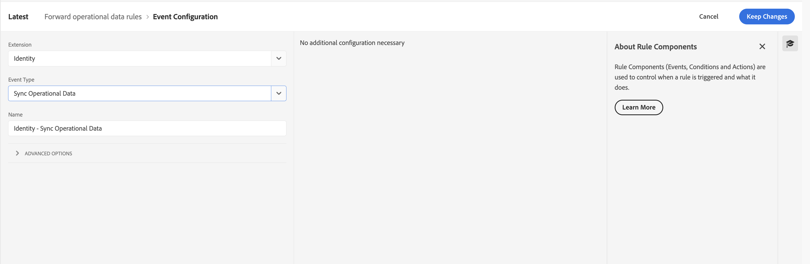
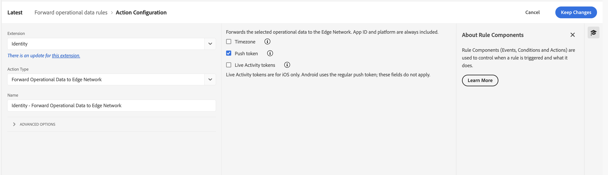

# Forward Operational Data to Edge Network tutorial

The **Forward Operational Data to Edge Network** rule action lets you select operational data from an SDK event and forward it to Edge Network. The underlying `forward-operational-data` consequence is supported in [Mobile Core](../../home/base/mobile-core/index.md) starting with **3.11.0 on Android** and **5.13.0 on iOS**.

This tutorial follows a timezone example using the **Identity** extension's **Sync Operational Data** event and **Forward Operational Data to Edge Network** action in the Data Collection UI.

## Prerequisites

Before creating the rule:

* Create a mobile property in Data Collection.
* Install the **Edge Network** and **Identity for Edge Network** extensions in the mobile property.
* For Messaging token synchronization, also install the **Adobe Journey Optimizer (Messaging)** extension in the mobile property.
* Add and register the corresponding SDK extensions in your app.

Use the following minimum SDK versions:

| Extension | Android | iOS |
| :--- | :--- | :--- |
| Core | 3.11.0 | 5.13.0 |
| Edge Network | 3.2.0 | 5.3.0 |
| Identity for Edge Network | 3.2.0 | 5.2.0 |
| Messaging | 3.14.0 | 5.18.0 |

The Messaging versions above support synchronization of tokens confirmed by Edge Identity. For dependency and initialization instructions, see [Identity for Edge Network](../../edge/identity-for-edge-network/index.md) and [Adobe Journey Optimizer](../../edge/adobe-journey-optimizer/index.md).

## Context

### How the consequence works

The [Rules Engine](../../home/base/mobile-core/rules-engine/index.md) evaluates a rule against the triggering SDK event. When a rule matches, this consequence copies values from explicitly enabled paths in the triggering event's data into a new event.

The **Forward Operational Data to Edge Network** action dispatches a new event using the type and source specified in the consequence's `detail`. The new event is chained to the triggering event as its parent. The action does not modify the triggering event.

Core performs filtering and event dispatch only. It does not check consent, deduplicate values, validate device tokens, add application or identity information, or make a network request. The receiving extension handles those responsibilities.

### Using the action

The action offers the following operational-data selections:

| Selection | Operational-data path | Platform |
| :--- | :--- | :--- |
| Timezone | `timezone` | Android and iOS |
| Push token | `tokens.pushNotification` | Android and iOS |
| Live Activity tokens | `tokens.liveActivityStart` and `tokens.liveActivityUpdate` | iOS only |

The Edge integration includes App ID and platform with the selected operational data. Core does not add these fields when dispatching the consequence event.

<InlineAlert variant="warning" slots="text"/>

Only select operational data approved for your use case. This action does not change the user's collect-consent preference or enable consent-independent Experience Events. A field left unselected in one action is not a global denial: another matching rule can still allow it.

## Example - Forwarding timezone to Edge Network

To create the rule, select your mobile property in the Data Collection UI and complete the following steps:

1. [Create a rule](#create-a-rule)
2. [Select the event that triggers the rule](#select-an-event)
3. [Select the action and the data to forward](#define-the-action)
4. [Save the rule and rebuild your property](#save-the-rule-and-rebuild-your-property)

### Create a rule

1. On the **Rules** tab, select **Create New Rule** or **Add Rule**.
2. Give the rule an easily recognizable name, such as **Forward operational data rules**.

### Select an event

1. Under the **Events** section, select **Add**.
2. From the **Extension** dropdown list, select **Identity**.
3. From the **Event Type** dropdown list, select **Sync Operational Data**.
4. No additional event configuration is necessary. Select **Keep Changes**.



### Define the action

1. Under the **Actions** section, select **Add**.
2. From the **Extension** dropdown list, select **Identity**.
3. From the **Action Type** dropdown list, select **Forward Operational Data to Edge Network**.
4. In the configuration pane, select **Timezone**. Leave **Push token** and **Live Activity tokens** unselected for this example.
5. Select **Keep Changes**.



The rule forwards the timezone supplied by the triggering event. It does not obtain a timezone or token by itself. To forward other operational data, select the corresponding options and ensure the triggering event supplies those values. Live Activity token selections apply to iOS only; Android uses the regular push token.

### Save the rule and rebuild your property

1. Select **Save**.
2. In **Publishing Flow**, create or update a library.
3. Include the rule and the required extension configuration in the library.
4. Build and publish the library for the environment used by your app.
5. Launch the app and confirm that it downloads the updated configuration and rules before testing.

### Verify the result

Trigger an operational-data update from your app, such as a call to `Identity.updateOperationalData` that supplies the timezone. Verify the SDK logs and the device attributes request in Assurance.

If no rule matches, or the matching rules allow none of the supplied fields, no device attributes request is sent. Identity may also skip values it has already confirmed when operational-data sync optimization is enabled.

## Consequence payload

The following sections describe the SDK consequence payload and its filtering behavior. They are a reference for understanding how the rule is processed; the Data Collection UI configures the action in the preceding example.

### Consequence detail fields

Set the consequence object's `type` to `forward-operational-data`. Its `detail` object supports these fields:

| Friendly name | Key | Type | Required | Description |
| :--- | :--- | :--- | :--- | :--- |
| Event type | `type` | String | Yes | Event type used for the dispatched event. This is distinct from the consequence object's type. |
| Event source | `source` | String | Yes | Event source used for the dispatched event. |
| Attribute selections | `attributes` | Array of objects | No | Paths to consider for forwarding. A missing, empty, or incorrectly typed value selects no attributes. |
| Attribute path | `attributes[].path` | Array of strings | Yes, for each selection | Non-empty sequence of exact dictionary keys to traverse in the triggering event data. |
| Attribute enabled | `attributes[].enabled` | Boolean | Yes, to forward the selection | Only Boolean `true` enables the path. A missing, false, or incorrectly typed value does not enable it. |

### Path selection and value handling

* Paths traverse dictionaries only. Use `["tokens", "pushNotification"]` for a nested value, not the dotted string `"tokens.pushNotification"`. A dot within a path segment is a literal part of that key. Array indexes and wildcard matching are not supported.
* Values are copied to the same path in the new event, preserving their types. Selecting an array or object copies the entire value; the consequence does not filter its individual elements or properties.
* Missing paths, paths through non-dictionary values, and paths resolving to `null` are omitted. Empty strings, empty arrays, empty objects, `false`, and zero are values and are preserved.
* Malformed path entries are skipped with a warning. Missing, empty, or incorrectly typed `attributes` also produces a warning.
* If no enabled path resolves to a value, Core still dispatches a chained event with an empty data object, provided the destination type and source are valid. An empty Core event does not imply that the receiving extension will send a network request.
* If the destination type or source is missing, Core logs an error and does not dispatch the consequence event. Forwarded events are subject to the Rules Engine's chained-dispatch limit.

Each consequence selects its own paths independently. Disabling a path in one consequence does not prevent another matching consequence from forwarding it.

### Payload example

The following SDK consequence example selects timezone and Live Activity push-to-start tokens, but disables the push notification token. It illustrates path filtering separately from the timezone-only UI example above.

```json
{
  "id": "forward-operational-data-example",
  "type": "forward-operational-data",
  "detail": {
    "type": "com.adobe.eventType.edgeIdentity",
    "source": "com.adobe.eventSource.responseOperationalData",
    "attributes": [
      { "path": ["timezone"], "enabled": true },
      { "path": ["tokens", "pushNotification"], "enabled": false },
      { "path": ["tokens", "liveActivityStart"], "enabled": true }
    ]
  }
}
```

Given this triggering event data:

```json
{
  "timezone": "America/Los_Angeles",
  "tokens": {
    "pushNotification": "push-token",
    "liveActivityStart": [
      { "attributeType": "GameScoreLiveActivityAttributes", "value": "start-token" }
    ]
  },
  "unselectedField": "not-forwarded"
}
```

The dispatched event contains this data. The Live Activity token array remains an array rather than being converted to a string:

```json
{
  "timezone": "America/Los_Angeles",
  "tokens": {
    "liveActivityStart": [
      { "attributeType": "GameScoreLiveActivityAttributes", "value": "start-token" }
    ]
  }
}
```
